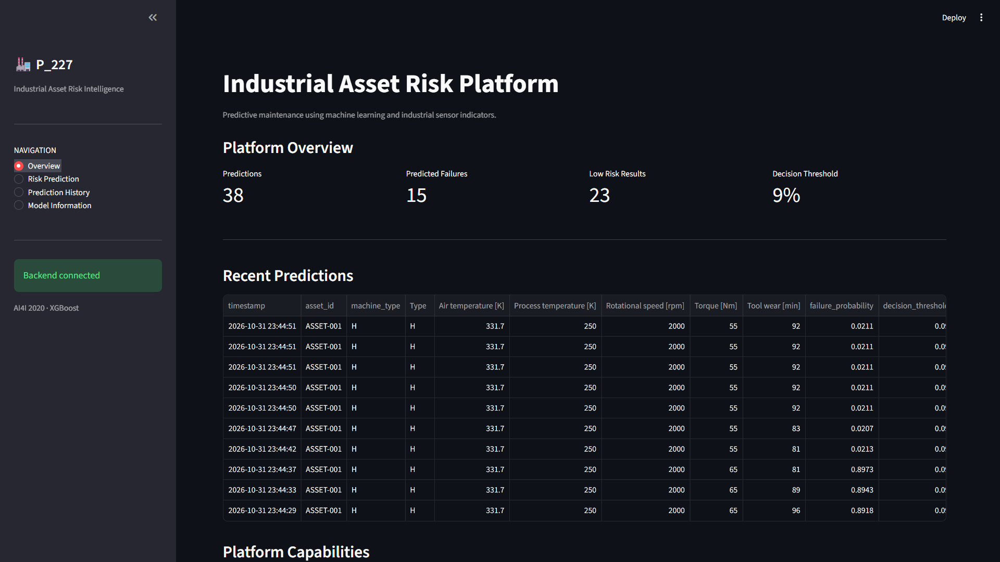
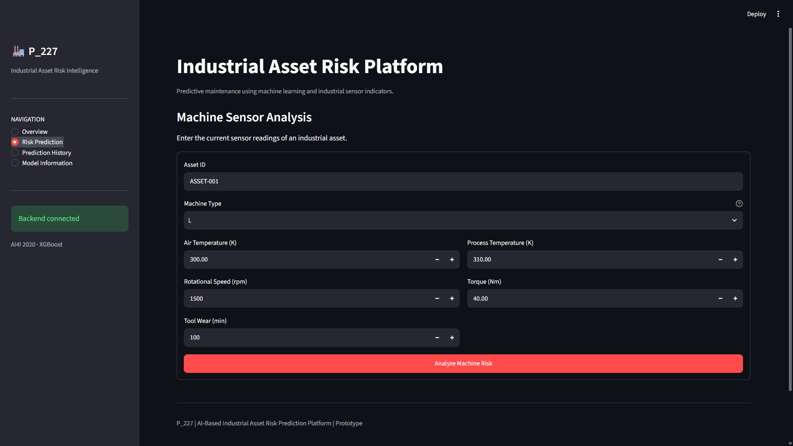
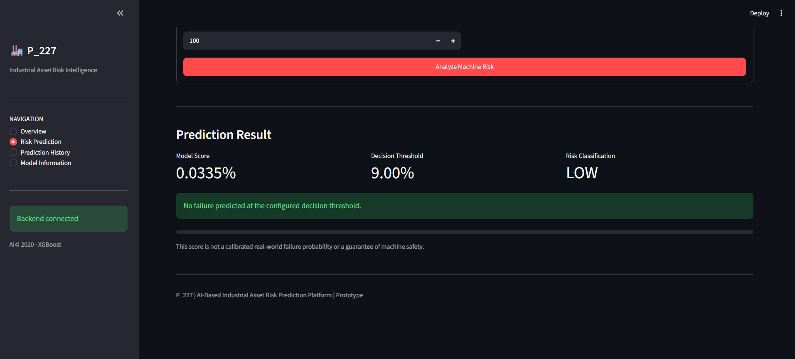
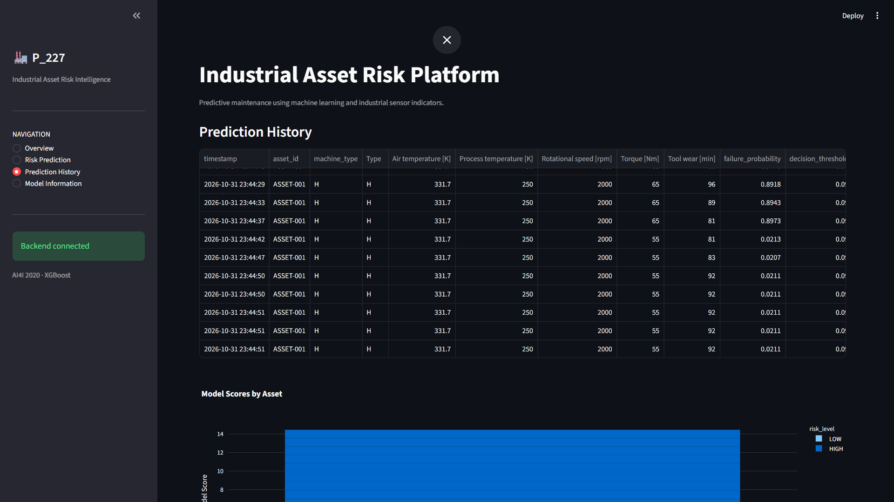
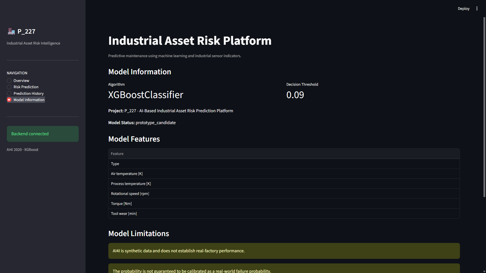

# 🏭 P_227 — AI-Based Industrial Asset Risk Prediction Platform

### Intelligent Predictive Maintenance Using Machine Learning

**An AI-powered industrial asset risk prediction system that analyzes machine sensor readings and identifies potential failure risks using an XGBoost classification pipeline.**


**Repository:** https://github.com/Vivek8840/Industrial-Asset-Risk-Prediction

---

<p align="center">
  
</p>

---

## 1. Project Overview

Industrial equipment failures can lead to unexpected downtime, maintenance expenses, and operational disruptions.

Traditional maintenance approaches often depend on fixed schedules or manual inspection. P_227 provides a data-driven alternative by analyzing machine operating conditions and sensor measurements to identify potential failure risks.

P_227 is an AI-based predictive-maintenance prototype that combines:

- Machine learning for failure-risk prediction.
- FastAPI for model inference and backend services.
- Streamlit for an interactive monitoring and prediction interface.
- A saved preprocessing and XGBoost pipeline for consistent inference.

The system accepts machine sensor readings, processes them through the trained model, and presents a risk classification to support maintenance review.

> **Project status:** Working local prototype. Public deployment and real-time industrial IoT integration are planned for future iterations.

## 2. Application Preview

### Dashboard Overview

<p align="center">
  
</p>

*Figure 1 — Main dashboard and system overview.*

### Machine Risk Prediction

<p align="center">
  
</p>

*Figure 2 — Entering machine sensor readings.*

### Prediction Results

<p align="center">
  
</p>

*Figure 3 — Model score, decision threshold, and risk classification.*

### Prediction History

<p align="center">
  
</p>

*Figure 4 — Historical predictions and risk-score visualization.*

### Model Information

<p align="center">
  
</p>

*Figure 5 — Model configuration, features, and limitations.*

## 3. Key Features

| Feature | Description |
|---|---|
| Machine Failure Prediction | XGBoost-based binary classification |
| Sensor Input | Accepts six machine input attributes |
| Risk Classification | LOW, ELEVATED, and HIGH risk categories |
| REST API | FastAPI-based inference endpoints |
| Interactive Dashboard | Streamlit-based application |
| Prediction History | Session-based prediction records |
| Model Information | Displays model features, threshold, and limitations |
| Modular Architecture | Separates UI, API, ML pipeline, and supporting modules |

## 4. System Architecture

The application follows a modular client-server architecture.

```mermaid
flowchart TD
    A["Operator / User"] --> B["Streamlit Dashboard"]
    B -->|"HTTP / JSON"| C["FastAPI Backend"]
    C --> D["Input Validation"]
    D --> E["Model Service"]
    E --> F["Saved ML Pipeline"]
    F --> G["Preprocessing"]
    G --> H["XGBoost Classifier"]
    H --> I["Failure Score"]
    I --> J["Threshold-Based Risk Classification"]
    J --> K["API Response"]
    K --> B
    B --> L["Prediction History"]