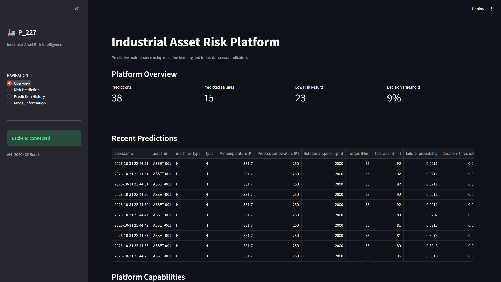
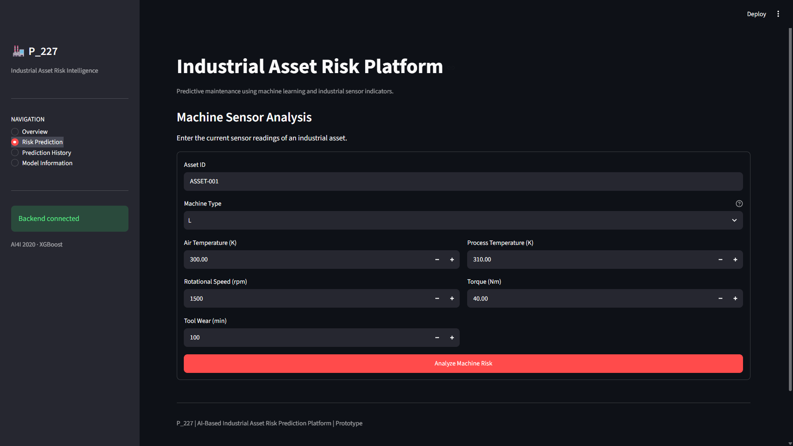
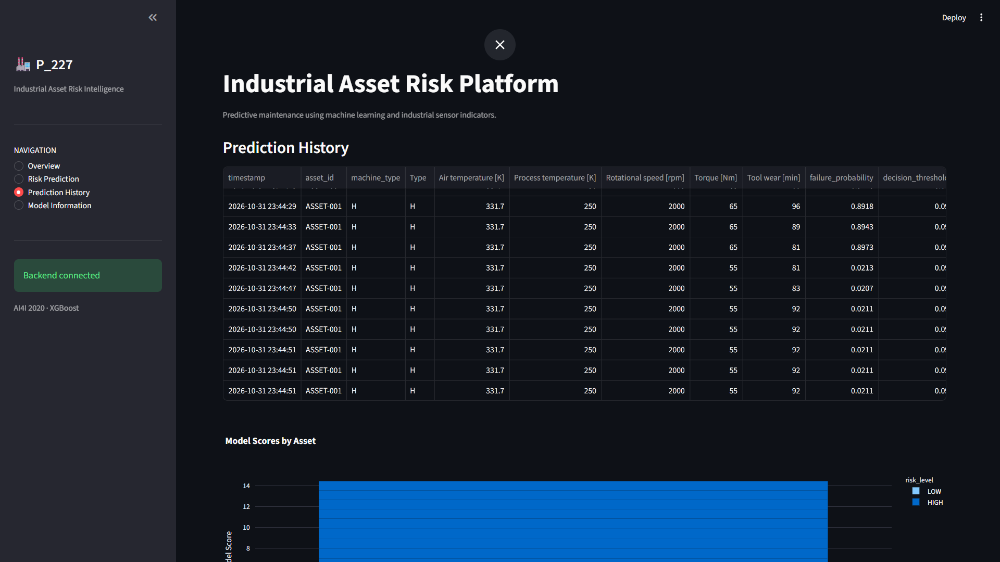
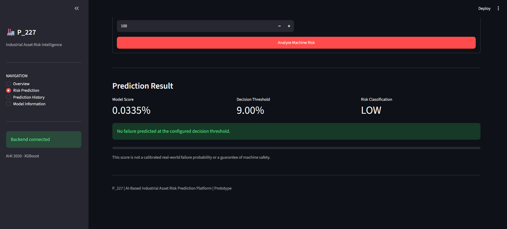
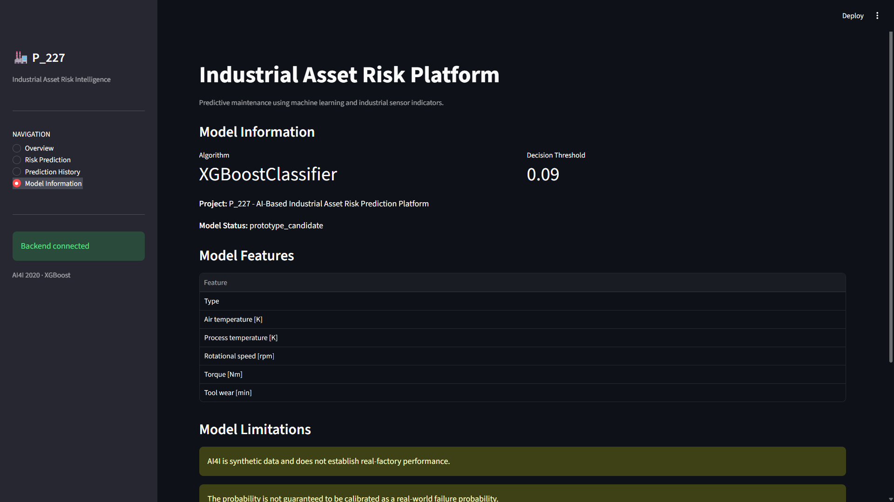
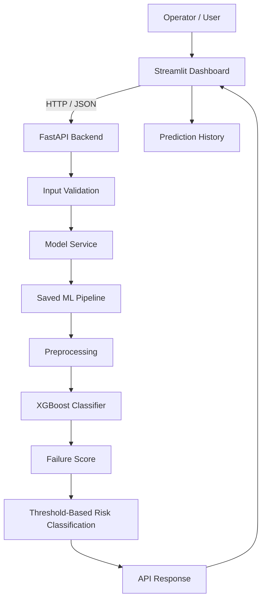

# 🏭 P_227 — AI-Based Industrial Asset Risk Prediction Platform

### Intelligent Predictive Maintenance Using Machine Learning

**An AI-powered industrial asset risk prediction system that analyzes machine sensor readings and identifies potential failure risks using an XGBoost classification pipeline.**


**Repository:** https://github.com/Vivek8840/Industrial-Asset-Risk-Prediction

---


<p align="center">
  
</p>

---

## 1. Project Overview

Industrial equipment failures can lead to unexpected downtime, maintenance expenses and operational disruptions.

Traditional maintenance approaches may depend on fixed schedules or manual inspection. P_227 explores a data-driven alternative by analyzing machine operating conditions and sensor measurements to identify potential failure risks.

P_227 is an AI-based predictive-maintenance prototype that combines:

- Machine learning for failure-risk prediction.
- FastAPI for model inference and backend services.
- Streamlit for an interactive monitoring and prediction interface.
- A saved preprocessing and XGBoost pipeline for consistent inference.

The system accepts machine sensor readings, processes them through the trained model and presents a risk classification to support maintenance review.

> **Project status:** Working local prototype. Public deployment and real-time industrial IoT integration are future steps.

## 2. Application Preview

### Dashboard Overview


<p align="center">
  
</p>

*Figure 1 — Main dashboard and system overview.*

### Machine Risk Prediction


<p align="center">
  
</p>

*Figure 2 — Entering machine sensor readings.*

### Prediction Results


<p align="center">
  
</p>

*Figure 3 — Model score, decision threshold and risk classification.*

### Prediction History


<p align="center">
  
</p>

*Figure 4 — Historical predictions and risk-score visualization.*

### Model Information


<p align="center">
  
</p>

*Figure 5 — Model configuration, features and limitations.*

## 3. Key Features

| Feature | Description |
|---|---|
| Machine Failure Prediction | XGBoost-based binary classification |
| Sensor Input | Accepts six machine input attributes |
| Risk Classification | LOW, ELEVATED and HIGH risk categories |
| REST API | FastAPI-based inference endpoints |
| Interactive Dashboard | Streamlit-based application |
| Prediction History | Session-based prediction records |
| Model Information | Displays model features, threshold and limitations |
| Modular Architecture | Separates UI, API, ML pipeline and supporting modules |

## 4. System Architecture

The current application follows a modular client-server architecture.



### Component Responsibilities

**Streamlit Frontend**
- Collects machine sensor readings.
- Communicates with the backend.
- Displays model scores and risk categories.
- Provides prediction history and model information.

**FastAPI Backend**
- Validates incoming requests.
- Loads the saved model pipeline.
- Executes inference.
- Applies the configured decision threshold.
- Returns structured prediction responses.

**Machine Learning Pipeline**
- Handles categorical and numeric features.
- Applies preprocessing.
- Generates failure scores through XGBoost.
- Converts model scores into classification decisions.

## 5. Machine Learning Pipeline

### Dataset

**AI4I 2020 Predictive Maintenance Dataset**

Source: [UCI Machine Learning Repository](https://archive.ics.uci.edu/dataset/601/ai4i+2020+predictive+maintenance+dataset)

| Attribute | Value |
|---|---|
| Total records | 10,000 |
| Target | Machine failure |
| Non-failure records | 9,661 |
| Failure records | 339 |
| Failure class proportion | 3.39% |

### Input Features

| Feature | Data Type |
|---|---|
| Type | Categorical |
| Air temperature [K] | Numerical |
| Process temperature [K] | Numerical |
| Rotational speed [rpm] | Numerical |
| Torque [Nm] | Numerical |
| Tool wear [min] | Numerical |

Identifier columns and failure-mode indicators are excluded from model inputs to avoid leakage.

### Model Development

- Algorithm: XGBoost Classifier
- Preprocessing: scikit-learn ColumnTransformer and OneHotEncoder pipeline
- Class weighting: None
- Random state: 42
- Stratified data split:
  - Training: 6,400 records
  - Validation: 1,600 records
  - Testing: 2,000 records

The preprocessing and classifier are stored together in a single joblib pipeline.

**Saved model:** `models/p227_xgboost_pipeline.joblib`

**Model metadata:** `models/model_metadata.json`

## 6. Risk Classification and Alert Policy

The model uses a validation-selected decision threshold of **0.09**.

Threshold selection rule:

1. Require validation recall of at least 0.80.
2. Maximize precision among qualifying thresholds.
3. Prefer a higher threshold in case of a tie.

### Application Risk Bands

| Model Score | Risk Level | Action |
|---|---|---|
| Below 0.045 | 🟢 LOW | Normal monitoring |
| 0.045 to below 0.09 | 🟡 ELEVATED | Review and monitor |
| 0.09 or above | 🔴 HIGH | Trigger a prototype alert |

The ELEVATED boundary of 0.045 is a provisional dashboard warning convention, not a separately validated threshold. The HIGH boundary of 0.09 is the selected model classification threshold.

**Important:** The model score is not guaranteed to be a calibrated real-world failure probability. A HIGH classification is a decision-support alert, not proof of imminent equipment failure.

## 7. Technology Stack

| Category | Technology |
|---|---|
| Programming Language | Python |
| Machine Learning | XGBoost, scikit-learn |
| Data Processing | Pandas, NumPy |
| Backend | FastAPI, Uvicorn, Pydantic |
| Frontend | Streamlit |
| Visualization | Plotly |
| Model Persistence | Joblib |
| Testing | Pytest |
| Version Control | Git, GitHub |

## 8. Repository Structure

```text
P_227/
│
├── backend/
│   ├── app/
│   │   ├── main.py
│   │   ├── schemas/
│   │   │   └── prediction.py
│   │   └── services/
│   │       └── model_service.py
│   ├── tests/
│   └── requirements.txt
│
├── dashboard/
│   ├── app.py
│   └── requirements.txt
│
├── config/
├── data/
│   ├── raw/
│   ├── processed/
│   └── splits/
│
├── docs/
│   └── images/
│
├── models/
│   ├── p227_xgboost_pipeline.joblib
│   └── model_metadata.json
│
├── notebooks/
├── reports/
├── scripts/
├── src/
├── tests/
│
├── .env.example
├── .gitignore
├── requirements.txt
└── README.md
```

## 9. Installation and Local Setup

### Prerequisites

- Python 3.10 or a compatible Python version.
- Git.
- Saved model pipeline and metadata.
- Compatible versions of XGBoost and scikit-learn.

### Step 1 — Clone the repository

```bash
git clone https://github.com/Vivek8840/Industrial-Asset-Risk-Prediction.git
cd Industrial-Asset-Risk-Prediction
```

### Step 2 — Install dependencies

```bash
python -m pip install -r requirements.txt
python -m pip install -r backend/requirements.txt
python -m pip install -r dashboard/requirements.txt
```

Use dependency versions compatible with the environment in which the model artifact was created.

### Step 3 — Start FastAPI

Open the first terminal:

```bash
cd backend
python -m uvicorn app.main:app --reload
```

Backend address:

`http://127.0.0.1:8000`

Interactive API documentation:

`http://127.0.0.1:8000/docs`

### Step 4 — Start Streamlit

Open a second terminal from the repository root:

```bash
streamlit run dashboard/app.py
```

Dashboard address:

`http://localhost:8501`

If required, configure the backend URL using an environment variable:

```env
API_URL=http://127.0.0.1:8000
```

## 10. API Documentation

The backend currently exposes the following endpoints:

| Method | Endpoint | Description |
|---|---|---|
| GET | `/health` | Checks backend and model status |
| GET | `/model-info` | Returns model configuration and metadata |
| POST | `/predict` | Generates a machine failure prediction |

### Sample Prediction Request

```json
{
  "Type": "M",
  "Air temperature [K]": 300.0,
  "Process temperature [K]": 310.0,
  "Rotational speed [rpm]": 1500,
  "Torque [Nm]": 40.0,
  "Tool wear [min]": 100
}
```

### Example Response Structure

```json
{
  "failure_probability": 0.00041296,
  "decision_threshold": 0.09,
  "predicted_failure": false,
  "risk_level": "LOW",
  "model_status": "prototype_candidate"
}
```

The numerical score above is illustrative. Actual results depend on the submitted sensor readings.

## 11. Application Workflow

1. Start the FastAPI backend.
2. Launch the Streamlit dashboard.
3. Check the backend connection status.
4. Open Risk Prediction.
5. Enter an asset identifier and machine sensor readings.
6. Submit the readings for analysis.
7. Review the model score, threshold and risk classification.
8. Open Prediction History to review session records.
9. Open Model Information to inspect the model configuration and limitations.

## 12. Evaluation and Interpretation

The project uses stratified training, validation and test partitions. The decision threshold is selected on validation data rather than being fixed at the default 0.50.

Formal model-performance results should be taken from `reports/final_test_metrics.json` and the evaluation report.

The test partition was also inspected during earlier exploratory threshold experiments. Therefore, test results should be interpreted as prototype evaluation rather than a completely untouched independent estimate of generalization.

## 13. Limitations

- AI4I 2020 is a synthetic dataset and does not establish performance on real factory equipment.
- Model scores are not guaranteed to be calibrated real-world failure probabilities.
- Unlabeled incoming telemetry does not automatically train or update the model.
- The current application uses manually entered sensor readings.
- Prediction history is session-based and is not persistent across users or sessions.
- MQTT, PostgreSQL and Grafana integrations are not currently part of the working application.
- The dashboard risk bands require operational validation before real-world use.

## 14. Future Enhancements

- Integrate ESP32-compatible sensor acquisition.
- Add MQTT-based real-time telemetry ingestion.
- Store assets, readings, predictions and alerts in PostgreSQL.
- Add Grafana dashboards for operational monitoring.
- Implement authentication and role-based access.
- Add controlled model versioning and retraining.
- Deploy the FastAPI backend and Streamlit frontend publicly.
- Validate the system using representative industrial equipment data.

## 15. Deployment Overview

The intended deployment uses two independent services.

```text
User Browser
     |
     v
Streamlit Community Cloud
     |
     | HTTPS API requests
     v
Render Web Service
     |
     v
FastAPI Backend
     |
     v
Saved XGBoost Pipeline
```

### Backend Deployment — Render

1. Connect the GitHub repository to Render.
2. Configure the backend working directory and dependencies.
3. Include the model artifact and metadata.
4. Configure the start command:

```bash
uvicorn app.main:app --host 0.0.0.0 --port $PORT
```

5. Deploy and verify `/health`, `/model-info` and `/predict`.

### Frontend Deployment — Streamlit Community Cloud

1. Connect the GitHub repository.
2. Select `dashboard/app.py` as the main file.
3. Configure dashboard dependencies.
4. Set `API_URL` to the public FastAPI service URL.
5. Deploy and verify an end-to-end prediction.

**Deployment status:** Public deployment is pending. The application has been demonstrated locally; it should only be described as deployed after both hosted services are working together.

## 16. Author

**Vivek Mani Tripathi**

B.Tech — Computer Science and Engineering (Data Science)  
ABES Engineering College, Ghaziabad

GitHub: [Vivek8840](https://github.com/Vivek8840)

Project Repository: [Industrial Asset Risk Prediction](https://github.com/Vivek8840/Industrial-Asset-Risk-Prediction)

## 17. References

- [AI4I 2020 Predictive Maintenance Dataset — UCI](https://archive.ics.uci.edu/dataset/601/ai4i+2020+predictive+maintenance+dataset)
- [XGBoost Documentation](https://xgboost.readthedocs.io/)
- [scikit-learn Documentation](https://scikit-learn.org/stable/)
- [FastAPI Documentation](https://fastapi.tiangolo.com/)
- [Streamlit Documentation](https://docs.streamlit.io/)

---

<p align="center">
  <b>P_227 — AI-Based Industrial Asset Risk Prediction Platform</b><br>
  <i>Turning machine sensor data into actionable maintenance insights.</i>
</p>

**Note:** This project is an educational and demonstration prototype. It is not a certified industrial safety or predictive-maintenance system.</WriteingBlock>

# 4. Before we finalize the README

There are three things we should verify rather than assume:

1. **Model evaluation:** We should insert the actual precision, recall, F1-score and PR-AUC from your `final_test_metrics.json`, not estimates.
2. **Screenshots:** We should use your real Streamlit screenshots, not stock images.
3. **Repository structure:** We should make sure the README matches the exact files currently committed to GitHub.

## 5. Your next step

Please upload or share these three things:

- Your current `reports/final_test_metrics.json`.
- A screenshot of the **Overview** page.
- A screenshot of **Prediction History** and **Model Information**, if available.

We already have your Risk Prediction and Prediction Result screenshots.

After we finalize this README, we'll prepare the synopsis report with:

- Project title and GitHub repository link.
- A proper project visual/banner.
- Problem statement and objectives.
- Proposed solution and system architecture diagram.
- Technology stack and dataset.
- ML methodology and actual results.
- Application screenshots with figure captions.
- Challenges, future scope and references.

The synopsis will be a formal HCL submission document, while the README will remain a technical guide for GitHub visitors and recruiters.